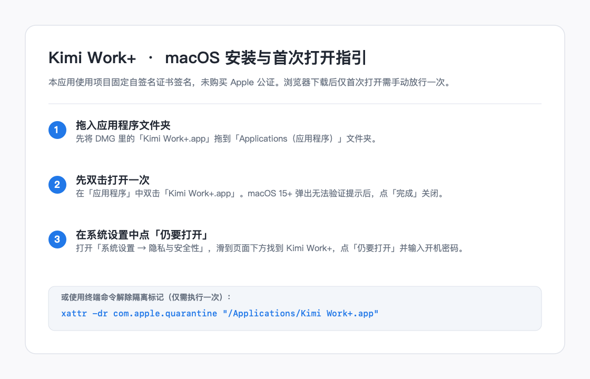
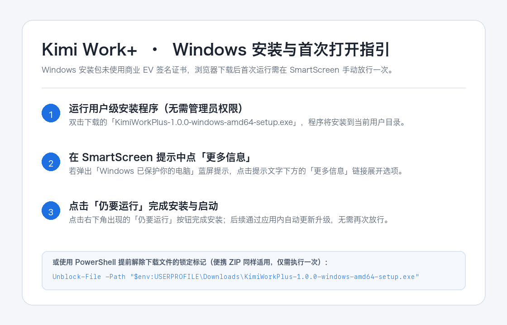

# KimiWork +

KimiWork + 是面向官方 **Kimi 桌面版 Work** 的本机模型网关与增强套件（Go + Wails 原生应用）。它在不修改官方程序包体的前提下，通过官方配置、页面接口、受管 CDP 管道和标准本地回环接口，为 Kimi Work 接入第三方模型服务商，并提供多账号热切换、用量账本、预算保护、故障转移与可选页面增强。接入方式分为默认的「本机网关模式」和可选的「零网关直连模式」，见下方[接入模式](#接入模式)。

> **开源许可**：本项目基于 [MIT License](LICENSE) 开源。

## 核心能力

- **第三方模型接入与协议路由**：在本地回环地址（`127.0.0.1`）运行轻量级 Go 网关，将外部 OpenAI 兼容 / Responses / Anthropic 等模型服务商接入 Kimi Work，支持自动同步模型列表、官方来源显示名升级为 `KimiWork +`，以及主备连接故障转移。
- **双接入模式**：默认「本机网关模式」完整保留用量账本、预算限制、故障转移、共享指令与网关侧联网搜索；可选「零网关直连模式」把服务商地址与密钥直接写入官方 Kimi 3.2.28+，同步完成后不依赖本机网关，退出本软件与后台服务仍可使用第三方模型。两种模式可随时切换，切换后需再同步一次。
- **Work 能力接管**：提供独立「子代理」一级入口，支持默认子代理与角色用途说明可视化配置并写入标准 `[secondary_model]` 模型池描述（实时回读确认，兼容零网关直连模式下的 `byok-<uuid>/模型` 别名），以及会话级并行模式（Swarm）开关与 MCP 配置管理。
- **多账号热切换**：在受管窗口下捕获和保存多个官方账号会话，支持顶栏一键切换（含任务忙碌保护、令牌过期状态提醒与失败自动回退原账号），额度与工作状态随账号实时切换。
- **用量账本与预算保护**：按请求记录 Token、耗时、费用估算与多来源额度；零网关直连与官方模型对话也会通过只读增量采集 Kimi Work 本地会话 `usage.record` 补齐 Token 统计（不读取对话文本，且与网关请求自动去重，不混入网关预算拦截）；网关模式支持按所选时区设置日/月预算提醒、拒绝策略与备用模型路由。
- **官方版本变化自检**：启动及检测到官方 Kimi 版本或内核变化时自动执行只读检查（模型目录探针、账号与模型接口、存储格式 `profiles` / `accounts`）；遇到不兼容变化时仅停止受影响功能的写入，其余功能继续运行。
- **国内镜像优先的应用内自动更新与回滚**：默认优先使用国内 CNB 镜像源检查与下载更新，失败时自动回退至 GitHub Releases，并统一执行 SHA-256 与内置 Ed25519 公钥验签；在 Kimi Work 与网关均空闲时原子替换并重启，新版本启动失败自动回滚，设置页支持手动回退上一版本。
- **清晰的五入口导航与新手引导**：顶栏收纳为「总览 / 模型 / 子代理 / 用量 / 设置」五个一级入口并按二级标签分栏，总览页提供可折叠/可跳过的 4 步快速上手引导，长页面滚动时顶栏保持常驻可见。
- **独立页面增强**：支持页面翻译等可选扩展，可单独开启或关闭，失效不影响主网关与官方 Kimi 启动。

## 支持的系统与官方版本

| 平台 | 系统要求 | 安装形态 | 说明 |
| --- | --- | --- | --- |
| macOS | macOS 13.0+（Apple Silicon & Intel Universal） | `.dmg` / `.zip`（内置 `Kimi Work+.app`） | 使用项目固定自签名证书签名，未购买 Apple 公证 |
| Windows | Windows 10 / 11（amd64），需系统自带 WebView2 | 用户级安装程序 `setup.exe` / 便携 `.zip` | 安装到当前用户目录，无需管理员权限 |

- **已验证兼容的官方 Kimi 桌面版本**：`3.2.27`、`3.2.28`（含 `3.2.28` 的 `accounts` v3 存储格式与新版路由目录解析）。
- 可选的零网关直连模式另外要求官方 Kimi `3.2.28+` 提供 `byokSources` v3 存储；更早版本只能使用本机网关模式。
- 新版本官方 Kimi 发布后，总览页会自动显示「新版本，基础检查通过」或具体的受影响功能提示，帮助在安全前提下判断是否可用。

## 安装与首次打开

打开 [GitHub 最新发行版](https://github.com/wssz527/kimiwork-plus/releases/latest)，在「Assets」中选择对应系统的安装包。可用同页的 `SHA256SUMS.txt` 核验下载文件。

### macOS 安装与首次打开

1. 下载文件名以 `-macos-universal.dmg` 结尾的安装包并打开，将 `Kimi Work+.app` 拖入右侧的 `Applications`（应用程序）文件夹。
2. 由于本应用使用项目固定自签名证书签名、未购买 Apple 开发者公证，通过浏览器下载后首次打开会被 macOS Gatekeeper 拦截（macOS 15+ 已不再提供右键“打开”绕过）。只需按以下任一方式放行一次：
   - **方法 A（系统设置）**：先在「应用程序」中双击一次 `Kimi Work+.app`，出现拦截弹窗后点「完成」关闭；随后打开「系统设置 → 隐私与安全性」，滑到页面下方找到 `KimiWork +`，点击「仍要打开」并输入开机密码确认。
   - **方法 B（终端命令）**：
     ```sh
     xattr -dr com.apple.quarantine "/Applications/Kimi Work+.app"
     ```
3. 从 v1.1.2 起，macOS 凭据保存在本应用的加密存储中，正常升级不再触发钥匙串授权。从旧版本首次升级时，如果旧钥匙串条目需要系统确认，可按页面提示完成一次迁移授权；迁移成功后不再询问。



### Windows 安装与首次打开

1. 下载文件名以 `-windows-amd64-setup.exe` 结尾的用户级安装程序。也可下载 `-windows-amd64.zip` 便携包，完整解压后运行 `KimiWorkPlus.exe`。
2. 浏览器下载后，首次运行可能触发 Windows Defender SmartScreen 提示「Windows 已保护你的电脑」。点击「更多信息」，再点击「仍要运行」。安装无需管理员权限。
3. 如需清除下载标记，在 PowerShell 中运行以下命令，按提示输入实际下载的 EXE 或 ZIP 完整路径。使用 ZIP 时先清除标记再解压。
   ```powershell
   Unblock-File -LiteralPath (Read-Host '输入下载文件的完整路径')
   ```



### 从预览版（Kimi Work+ Preview）升级

正式版首次启动会自动检测旧预览版目录与钥匙串凭据：

- 自动迁移配置、用量账本、账号索引，以及旧预览版钥匙串中的服务商 API Key 与账号凭据到本应用的加密存储；
- 迁移全部确认完成前不删除旧预览版数据，旧后台服务标签会被平稳切换；
- 如果钥匙串在首次迁移时弹出系统授权确认，按系统提示允许即可，无需手动重新填写 Key。

## 接入模式

接入方式在 **设置 → Kimi 接入** 中选择，默认是「本机网关模式」。切换模式只是保存偏好，不会立刻改动官方 Kimi；必须再点一次 **同步到 Work**，才会把新的接入方式写入官方客户端。

### 本机网关模式（默认）

模型请求经本机回环网关转发，因此可以使用全部网关侧能力：用量账本与预算提醒/拒绝、主备连接故障转移、共享指令，以及由本软件接管的联网搜索与抓取。在 **设置 → 版本、更新与后台服务** 中允许登录时启动后，后台服务会在登录时自动运行，平时无需打开 KimiWork + 主窗口；窗口关闭也不停止网关。

### 零网关直连模式（可选）

直连模式把服务商地址、协议与模型目录直接写入官方 Kimi 的 `byokSources` 自定义模型源，让官方 Kimi 自己访问服务商，不再经过本机网关。

- **前提**：需要官方 Kimi 3.2.28+ 的 `byokSources` v3 存储。版本自检不满足时，设置页会提示改用本机网关模式。
- **操作顺序**：先在设置页选中「零网关直连模式」，打开受管的 Kimi 并登录，再点 **同步到 Work**（设置页同名按钮在直连模式下显示为「写入直连配置并同步」）。同步会先把官方内网域名 `dev.msh.team` 指向一个私有地址写进静态 hosts（官方客户端只接受私网解析结果）；macOS 还会在同一次提权里清理旧版本留下的单域名 DNS 配置。这一步需要系统管理员授权：macOS 在条目就位且旧配置已清理后不再询问，Windows 在静态 hosts 条目就位且解析探测通过后也不再重复弹窗。
- **同步之后**：退出 KimiWork + 与后台服务，直接双击官方 Kimi 仍可使用这些第三方模型。总览页的同步状态会显示「直连已就绪」；若静态 hosts 还差一步，会显示「待补齐静态 hosts」并提示再同步一次。如果模型页出现「需要重启 Kimi」，按提示正常重启一次官方 Kimi。
- **凭据与目录**：API Key 在同步时写入官方 Kimi 自己的本机凭据存储，之后由官方客户端保管。同步用的原始 Key 来自本产品已保存的连接凭据（macOS 应用内加密存储 / Windows DPAPI），直连记录本身只保存服务商、模型、别名与账号摘要，不复制一份 Key 明文。
- **不生效的能力**：直连下请求不经过网关，因此预算限制、备用连接故障转移、共享指令、网关侧联网搜索以及单次请求耗时/首字节延迟都不参与请求；设置页会显示「以下已开启的功能在直连模式下不生效」并列出具体项。Token 用量仍会通过只读增量采集 Kimi Work 本地会话 `wire.jsonl` 的 `usage.record` 自动汇总到「用量」页（只读数字字段，不读取对话正文）。思考翻译与多账号热切换仍由本软件提供，需要保持 KimiWork + 运行。
- **需要重新同步**：更改已同步的模型或服务商、或在官方 Kimi 更新之后，重新打开本软件，到 **模型** 页点一次 **同步到 Work**。导入时只写入已声明工具调用、已绑定连接、地址合规且有可用密钥的模型；其余模型会在设置页列出跳过原因（未声明工具调用、未绑定连接、地址不支持直连、协议不支持、端点与协议重复、未配置密钥等）。
- **切回网关**：在设置页选回「本机网关模式」并再点一次 **同步到 Work**。本软件先写入并应用网关来源，再断开旧的直连模型源；如果新来源导入失败，旧直连不会被预先断开。旧来源清理失败时会显示「切换收尾未完成」，再次同步即可重试。

## 快速上手

### 1. 首次接入第三方模型

1. 启动 `KimiWork +`，确认顶栏状态显示「网关运行中」，总览页的「官方 Kimi 兼容」自检通过。
2. 切换到 **模型** 页，点击 **添加服务商**，填写服务商地址（Base URL）与 API Key 并保存。随后点击 **添加模型**，或从服务商读取模型目录并选择模型，再保存。
3. 从 **总览** 页启动受管的 Kimi Work，并在官方窗口登录。回到 **模型** 页，点击 **同步到 Work**，把已保存的模型同步到当前账号。

   服务商向导会带入预设及上游目录已知的名称、上下文、输出和思考档位；未知信息仍需自行确认。保存成功后表单收起并回到模型目录，保存失败则保留已填内容与 API Key。本机目录保存成功后仍需单独同步到 Work。
4. 如果页面显示「需要重启 Kimi」，点击 **重启 Kimi**。同步完成后，在官方 Kimi Work 的模型选择器中选择已接入的第三方模型。

如果打算使用零网关直连模式，在第 3 步之前先到 **设置 → Kimi 接入** 选中「零网关直连模式」，其余步骤相同；同步时可能先处理一次静态 hosts 的系统授权，完成后即可退出本软件与后台服务。

### 2. 多账号热切换

1. 先确保官方 Kimi 由 KimiWork + 受管启动，进入顶栏 **账号管理**，点击捕获当前已登录账号。
2. 点击 **添加账号**，在弹出的官方登录界面登录第二个账号，完成后保存快照。
3. 之后可直接在顶栏下拉框或系统托盘切换账号。如果当前 Work 仍有任务在运行，KimiWork + 会拒绝中断并提示等待空闲；切换异常时会自动尝试恢复原账号。

### 3. 自动更新与回滚

- 在 **设置 → 接入与更新** 中可查看当前版本、更新源、更新渠道、上次检查时间，并开关自动检查更新。点击「查看发布页」会直接调起系统默认浏览器访问对应发布页；应用内检查失败时，也可从 [CNB 国内镜像发布页](https://cnb.cool/wssz527/kimiwork-plus/-/releases) 或 [GitHub 最新发行版](https://github.com/wssz527/kimiwork-plus/releases/latest) 下载当前系统的安装包。
- 默认优先通过国内 CNB 镜像检查更新和下载安装包，不可达或校验异常时自动回退到 GitHub Releases；无论走哪条源，最终都经过同一份内置 Ed25519 公钥与 SHA-256 验签。
- 启动后及每日自动检查只发现新版本，不会在后台静默下载。发现更新时，总览页显示新版本卡片，其他页面显示顶部横幅，手动检查时另有结果提示；点击 **前往下载并更新** 可进入设置页。
- 只有主动点击 **下载并更新** 才会下载安装包。下载完成后程序会校验 SHA-256 与内置 Ed25519 签名，并等待 Kimi Work 与网关空闲后再替换重启；等待期间可取消更新。
- v1.1.2 起，macOS 使用应用内 AES-GCM 加密存储，升级后的后台与界面读取已迁移凭据不再需要钥匙串授权。旧版本首次升级会优先在后台迁移；仅当旧钥匙串条目本身要求确认时，页面才显示「连接凭据待授权」，可在 **模型** 页点 **重新授权并应用连接** 完成一次迁移。新凭据写入并读回一致前不会删除旧条目，取消或拒绝不会改动已保存的连接。
- 若新版本启动失败或后台未就绪，启动保护会自动回滚到上一版本；你也可以随时在设置页点击 **回退到上一版本**。
- 自动更新只管理 KimiWork + 自身，不代理、不拦截、不修改官方 Kimi 的更新流程。

## 版本说明

- **v1.1.7（当前版本）**：
  - **移除模型接管并还原官方配置**：新增一键移除模型接管操作，安全断开本软件托管的回环网关与直连自定义模型源，恢复当前账号的官方默认模型配置并保留本地服务商目录与历史记录；显式同步与断开操作在需要时自动拉起受管 Kimi 并激活 Work 视图。
  - **预览通道与跨平台更新稳定性**：预览通道更新检查改为优先请求 CNB 发布列表并按语义版本择优，与 GitHub 双向互备；Windows 自动更新改为先优雅停机守护进程、回滚恢复后同步刷新服务与卸载元数据，卸载器改为非递归安全清理空目录；Windows 直连模式在静态 hosts 与解析就绪后不再重复弹出 UAC。
- **v1.1.6（历史）**：
  - **模型同步稳定性**：等待官方 Work 与设置页完成挂载，恢复失效只读会话；真实模型写入不自动重放，修复超时、断连、账号边界与待重启回执状态。
  - **模型编辑与本地诊断**：自定义模型支持名称、上下文、输出、能力、思考档位和默认档位；保存成功收起向导，失败保留表单与 Key；设置页支持导出脱敏诊断日志，不自动上传。
  - **Windows 登录目录与连续更新**：支持通过安全校验的官方登录目录 Junction；预览清单按同标签优先读取 CNB 并回退 GitHub；从本版起，预览通道可升级到更新的正式版，旧版首次升级本版时可先手动切换到稳定通道。
- **v1.1.5（历史）**：
  - **更新取消与重试隔离**：修复取消下载或回退后立即重试时，旧协程及其延迟进度事件取消或覆盖新任务状态的问题；下载、校验、等待空闲与回退均按操作代次隔离。
  - **CNB 镜像发布完整性**：稳定版同步在 `main` 分支推送失败时立即中止，不再继续推送标签和发布资产，避免镜像分支与发布版本不一致。
- **v1.1.4（历史）**：
  - **国内镜像优先更新与外链修复**：默认优先从国内 CNB 镜像检查和下载更新，失败自动回退 GitHub Releases，统一使用同一份相对路径清单与 Ed25519 验签；更新下载支持停滞超时保护并在跨源重定向时清理鉴权头；桌面 WebView 中点击「查看发布页」改为由后端校验 HTTP(S) 后调起系统默认浏览器。
  - **五入口导航重构、顶栏防滚失与新手引导**：顶栏重构为「总览 / 模型 / 子代理 / 用量 / 设置」五个一级入口并按二级标签分栏；移除生产代码中的 `scrollIntoView` 与根元素 `overflow: clip`，固定外层 `.shell` 仅在 `.main` 内滚动，根治 macOS WKWebView 长页滚动时顶栏滚出视野的问题；总览页新增子代理摘要卡与 4 步可折叠/可跳过的新手引导（可在设置页重新打开）。
  - **直连子代理与模型池配置**：支持直连模式下按 `native-work-intent.json` 自动解析 `byok-<uuid>/模型` 别名写入官方 `config.toml` 并回读确认；新增默认子代理与角色用途说明可视化配置并写入模型池描述；切换继承/固定/模型池模式时保留未保存草稿。
  - **直连与官方会话用量统计**：新增只读增量 `wire.jsonl` `usage.record` 采集器，自动补齐零网关直连与官方模型会话的 Token 统计并与网关账本去重（不读对话正文、不混入网关预算拦截）。
  - **兼容与健康检查增强**：修复官方 Kimi 3.2.28 下 Tower 能力检测误报；补齐账号令牌过期提醒与慢速/并发更新状态保护。
- **v1.1.3（历史）**：修复慢速网络下 GitHub 更新下载被固定总超时中断的问题；下载保留取消能力，检查更新仍使用原有超时。包含 v1.1.2 的 macOS 凭据迁移与升级授权修复。
- **v1.1.2（历史）**：macOS 服务商、翻译、搜索与账号凭据改用应用内 AES-GCM 加密存储，正常升级不再因签名变化触发钥匙串授权；支持从旧钥匙串条目安全迁移，新存储读回一致后才清理旧条目。Windows 继续使用 DPAPI。
- **v1.1.1（历史）**：修复新增服务商表单默认选中预设或填入示例值的问题，新建表单默认保持自定义空白。
- **v1.1.0（历史）**：新增可选的「零网关直连模式」，把服务商与模型直接写入官方 Kimi 3.2.28+，同步后可退出本软件与后台服务。默认行为仍是本机网关模式，升级后既有连接、模型、账本与账号配置保持不变。同时包含：macOS 后台服务日志改写到后台状态目录（未设置时为 `~/Library/Logs/KimiWorkPlus/`），不再与 LaunchAgent 定义混放，并在卸载时清理旧版本留在 `LaunchAgents` 的日志；受管 Kimi 正常退出后释放页面动作通道，避免重开时复用失效引用；系统凭据报错文案不再使用「预览版」措辞；移除账号或重新捕获账号后不再保留上一次切换失败/回滚的过时提示；识别 `byok-<uuid>/模型` 形式的官方模型别名；清理旧 Node 版遗留的 `byok-kwp-*` 死服务商与模型。
  Windows 修复了 WebView2 初始化时主题设置可能导致的偶发启动崩溃。
- **v1.0.2（历史）**：首启、预览版迁移与后台端口漂移自愈；等待阶段自动重试；Windows 托盘与外壳缓存刷新；官方 Kimi 3.2.28 端口切换后的 `route-selection-required` 修复；账号切换失败恢复解锁与轮换令牌后台同步。
- **v1.0.1（历史）**：仓库与模块改名为 `kimiwork-plus`、产品显示名统一为 `KimiWork +`，顶栏品牌显示修正，许可切换为 MIT。
- **v1.0.0（历史）**：首个正式版，包含网关接入、多账号热切换、用量账本与预算、应用内自动更新与回滚。

## 隐私与安全说明

- **凭据隔离存储**：KimiWork + 在 macOS 当前用户的应用目录中用 AES-GCM 加密保存服务商、翻译、搜索 API Key 与账号快照，目录和文件权限限制为当前用户；Windows 使用 DPAPI。macOS 主密钥与密文位于同一应用存储中，这不是 Secure Enclave 或系统钥匙串保护，不能抵御已经控制同一用户会话的进程。切换账号时会将当前登录所需的凭据写回官方 Kimi 的会话与配置，由官方客户端继续管理。
- **仅本机回环监听**：本机网关与面板接口只绑定 `127.0.0.1` 回环地址，并要求私有会话令牌与来源校验，不向局域网或公网暴露端口。直连模式写入期间，服务商密钥同样只经本机回环管道传给官方页面，不写入本软件的配置、状态目录或日志；写入完成后由官方 Kimi 自己保存。
- **账本与诊断脱敏**：本地用量账本（`ledger.jsonl`）、版本兼容报告（`official-compat.json`）及诊断信息不包含任何 API Key、Cookie 或令牌原文。设置页的「导出诊断日志」会下载一份 JSON 报告，记录操作阶段、耗时、失败代码和版本等摘要，不含连接地址、文件路径、账号明细或模型来源标识；报告仅供你自行检查和分享，不会自动上传。
- **零官方包篡改**：不修改官方 `Kimi.app` / `Kimi.exe` 文件与签名；修改官方配置前保留备份机制，并拒绝静默覆盖来自其他来源的第三方配置。

## 已知限制

- **依赖官方内部契约**：核心模型接入与多账号能力依赖官方 Kimi 桌面版的内部私网开关（`dev.msh.team` 判定）及页面接口。若官方未来移除或大幅变更相关机制，对应功能将由兼容自检自动保护停写，直至适配新版本。
- **官方 Work 内核差异**：当前官方桌面版 Work 的内置内核未暴露 Tower 入口，面板会明确显示未支持而不伪造入口；Swarm 与普通子代理共享当前内核的 `secondary_model` 配置。
- **签名与系统拦截**：未购买 Apple 开发者公证与 Windows 商业 EV 证书，浏览器首次下载安装需按上方指引手动放行一次。v1.1.2 起 macOS 凭据不再绑定应用签名或钥匙串 ACL；从旧版本迁移时，只有旧条目自身要求确认才可能出现一次系统授权。
- **预算估算属性**：预算控制依据本地配置单价与本机网关账本估算，不代表上游服务商的最终计费或硬限额；串行模式下最后一笔已放行请求仍可能轻微超过阈值。直连模式下预算与账本不参与请求，这条限制同样不适用。
- **直连模式依赖官方 `byokSources` v3**：该模式要求官方 Kimi 3.2.28+ 提供 `byokSources` 的列表、预览、保存与断开接口。官方更改接口或存储格式后，直连写入会被拒绝并保留原配置，此时可切回本机网关模式继续使用。
- **静态 hosts 与安全软件**：首次直连同步需要写入一条静态 hosts 记录（`dev.msh.team` 指向本产品使用的私有地址）。若该域名已被其他软件或企业策略配置为不同地址，本软件会报告冲突而不是覆盖；主机安全软件拦截 hosts 修改时同样会失败并给出提示。切回本机网关模式不会自动删掉这条记录；需要清除时，在 **设置** 页展开 **高级恢复选项**，点击 **移除单域名 DNS**。
- **当前验证边界**：macOS 与 Windows 均已完成 1.0.0 核心能力、官方 3.2.28 兼容自检、模型同步、双账号热切换、用量账本与双端自动更新/回滚真机验证；真实系统注销再登录后的后台自启与长期闲置令牌寿命仍待长期实机观察。1.1.0 新增的零网关直连模式不在上述 1.0.x 验证结论范围内，其验收状态以该版本发布说明为准。

## 从源码构建

需要 Go 1.26.10（见 `go.mod`）。克隆仓库后可直接编译或使用打包脚本：

```sh
# 运行全部测试与静态检查
go vet ./...
go test -count=1 ./...
go test -race -count=1 ./...

# 构建 macOS Universal 应用与 DMG
VERSION=1.1.7 BUILD_ID=1.1.7-local bash build/macos-dmg.sh

# 交叉构建 Windows amd64 便携包与用户级安装程序
VERSION=1.1.7 BUILD_ID=1.1.7-local bash build/windows.sh
```

更多关于证书管理、自动更新签名工具（`cmd/signrelease`）、独立开发态运行参数与架构契约的说明，请参阅 [BUILDING.md](BUILDING.md) 与 [internal/kimi/INTERFACE.md](internal/kimi/INTERFACE.md)。

## 许可证、第三方声明与贡献

- **开源许可**：[MIT License](LICENSE)。
- **第三方组件声明**：见 [THIRD_PARTY_NOTICES.txt](THIRD_PARTY_NOTICES.txt)（包含 macOS 与 Windows 构建涉及的全部第三方 Go 模块原始版权与许可全文）。
- **贡献说明**：提交 PR 或补丁前请阅读 [CONTRIBUTING.md](CONTRIBUTING.md)。
